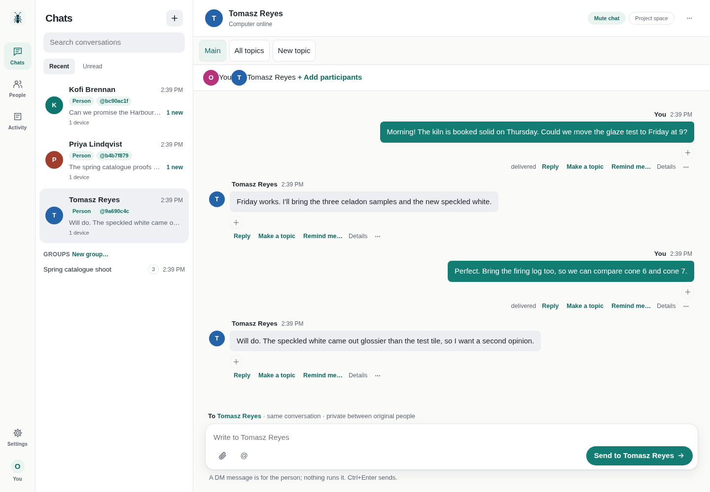
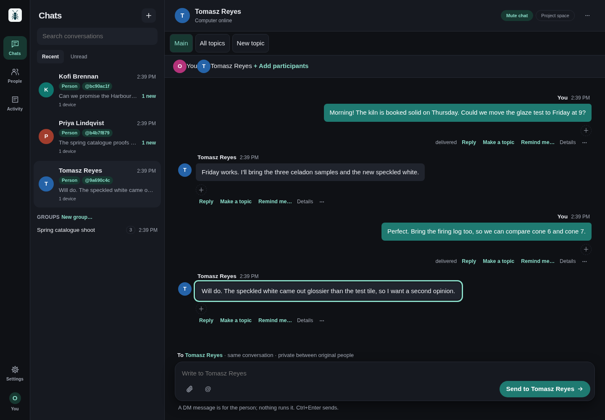
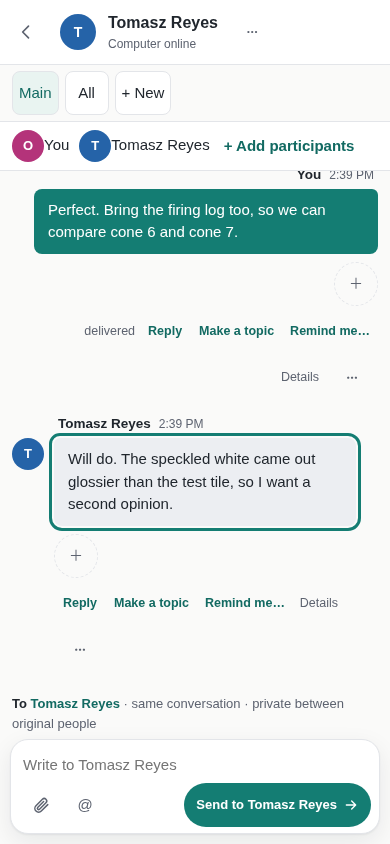
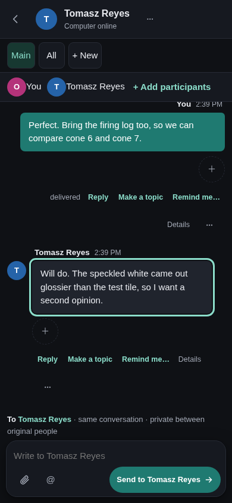

# Classic

AgentNet's original interface, now a collection skin: your chats in a list beside the open conversation, with topics, people and their devices, agents, activity and decisions, profile and settings, file previews and downloads, notifications and the optional project-space and app controls. Plain, familiar and quick on a desktop or a phone, in light and dark.

Classic was built into AgentNet up to v0.8.24. From v0.8.25 AgentNet keeps only Comic built in, and Classic installs from this collection (or the in-app skin gallery) like any other skin.

## Preview

Actual AgentNet rendering through the production loader with a disposable fictional company (Brightwater Ceramics: invented people and messages, `npm run previews`); Host API v1 on AgentNet `3ba44749` (v0.8.32). These previews show the skin's own area on a desktop (1440 × 1000) and a phone viewport (390 × 844), with light and dark themes; Host tools are available through Settings. Phone screenshots use Chromium emulation.

The release candidate pin is AgentNet v0.8.32 at `ac98b331`. These inspected previews were rendered on `3ba44749`, whose production, generated and runtime source bytes are identical to this candidate. The full collection gate passed against this exact candidate. Proposed gallery release `v2026.10.16.2` is not published.

| Desktop light | Desktop dark |
| --- | --- |
|  |  |

| Phone light | Phone dark |
| --- | --- |
|  |  |

Build: `node scripts/build.mjs classic` from the repository root. Install or import `dist/classic/` as described in the [main README](../../README.md). Targets Host API v1; `"agentnet": "v0.8.32"`. Drafts are namespaced by manifest identity and workspace; staged files are retired after a reconnect rather than replayed. No code, image or import needs a sibling skin, a CDN or a network service.

## v0.8.26 usability corrections

From the owner's review ("can't reach settings", "can't even enter the message mode") and a rendered review of every flow, desktop and phone:

- A labelled **Settings** item (gear) sits beside **You** in the navigation, desktop and phone; Settings opens Appearance (theme and the skin to switch to), You opens your profile. Settings was only reachable through the You avatar.
- Asking an agent this device runs no longer fails with "Reply receiver has no eligible original recipient copy": a local job gets no default reply receiver (there is no request copy to bind it to, and its answer comes back in the conversation anyway); a receiver you choose is still sent and checked.
- Choosing an assistant from the @ list keeps what you typed bound to it, so one Send asks it (it used to answer "You started this text for someone else").
- After an ask the composer writes to the conversation again, as Comic does. A failed ask restores its assistant with the text, but never over a newer choice; Retry asks the assistant it was written for, and its pending message says which.
- The @ Mention row is shown only for agents that can still be asked (not ended or declined ones).
- New topic shows as the chosen topic button, and the To line says "starts a new topic" until you send or pick another topic.
- Opening a chat whose newest item is an event line (an agent invited or removed) no longer throws.
- Conversation details holds the chat's Mute (and, for a DM with a person, Project space) too, since a phone hides the header chips.
- Closing the Project space and opening it again in the same chat shows it again (it stayed empty).
- On a phone or any touch screen, message actions, list-heading actions, settings tabs and close, topic buttons and Back are at least 44px to tap.
- The blank 56px band under the interface is gone: it was kept free for a host control that now sits above every skin.

## Provenance

Moved from [AgentNet](https://github.com/misunders2d/agentnet) at commit `b9c2a6e78be1d34f38f737517a7a5b0fe53a83b6`: the embedded package `internal/ui/static/skins/classic/`, built there from `internal/ui/skins/classic/src/`, the shared modules in `internal/ui/skins/shared/` (topics, person topics, mentions, reaction preferences, link text) and `internal/ui/static/` (pictures, optimistic sends). Apache-2.0, see [LICENSE](../../LICENSE) and [NOTICE](../../NOTICE). `qr.mjs` retains Paul Miller's copyright and `MIT OR Apache-2.0` notice; `link-text.mjs` bundles the marked Markdown lexer with its MIT and Markdown licence text, kept at the end of the file.

Changes from those bytes, only what the contract or this repository's checks require (the checks hold every standalone skin to the same journeys as Holonet):

- Identity comes from the package's own manifest (`manifest.id`) instead of the undocumented `host.skin` (drafts namespace `skinKey`, and `ownSkin` for the skin list), as Holonet does.
- Four `style` attributes set through `el()` (the proposal text in "How this task was chosen", the app-link fallback `<code>`, and the AgentNet command location) became CSS classes `proposal-text`, `copy-link` and `wrap-anywhere`, appended to `style.css`: AgentNet's content security policy (`style-src 'self'`) blocks style attributes, and this repository's source lint rejects them.
- The settings dialog's `close` listener is registered with the skin's unmount signal (`on(...)`), so a close event delivered after unmount no longer throws (`Cannot read properties of null (reading 'open')`, seen in the lifecycle check).
- `skin.json` adds `"agentnet": "v0.8.25"`: v0.8.24 and older reserve the id `classic` for their built-in copy.
- Opening a file keeps its Download link when the view redraws while the file is still loading, so Open need not be chosen again (as Holonet does).
- Dark theme: the accent is `#1f7a71` (was `#329e92`), so white text on outgoing messages and primary buttons measures 5.15:1 (was 3.26:1, below 4.5:1).
- Phone: Send keeps a 44px touch target (it was 35.5px tall).
- A conversation row opens at its latest message. While that message is still loading (a new browser device syncing its history), writing in the conversation or opening it again by hand now cancels the jump, so the view no longer moves to another topic under the person.
- The conversation list is drawn only once the first overview has arrived; choosing a section earlier no longer throws (`Cannot read properties of undefined (reading 'threads')`).

Everything else, apart from the v0.8.26 usability corrections above, is byte-identical to `internal/ui/static/skins/classic/` at `b9c2a6e7`; `manifest.mjs` is generated by `scripts/build.mjs` from `skin.json`.

Catching up with Comic's newer features comes later; these changes only make the moved skin pass this collection's checks. Before the move, AgentNet shipped this code up to v0.8.24 with the issues above.
