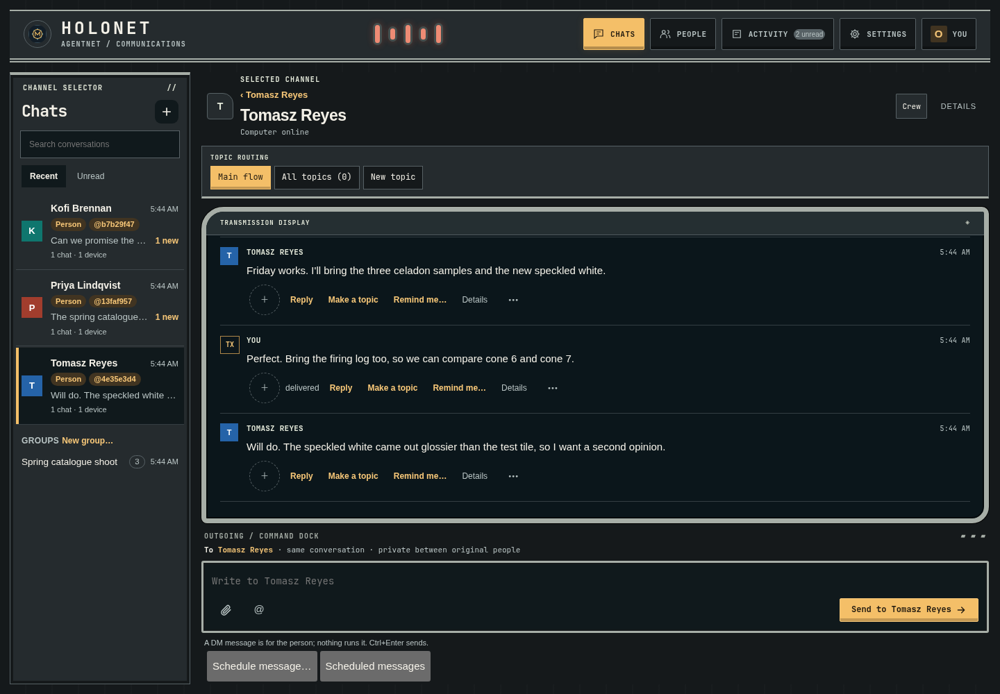
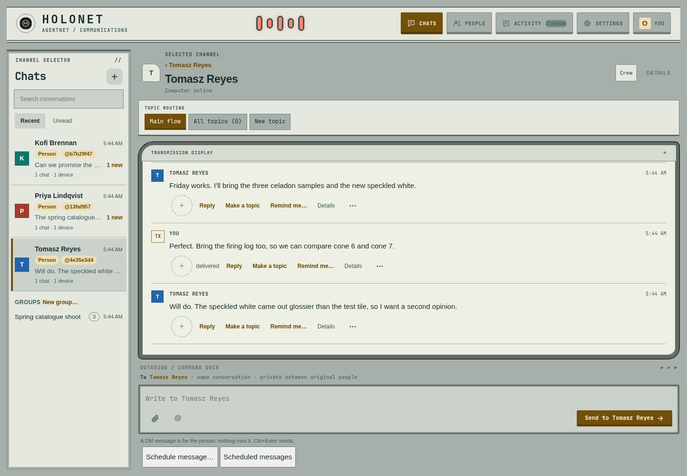
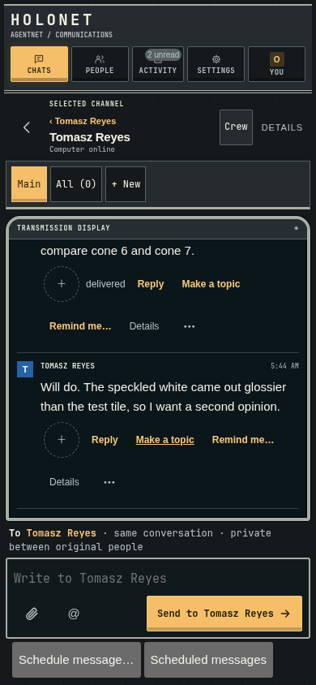
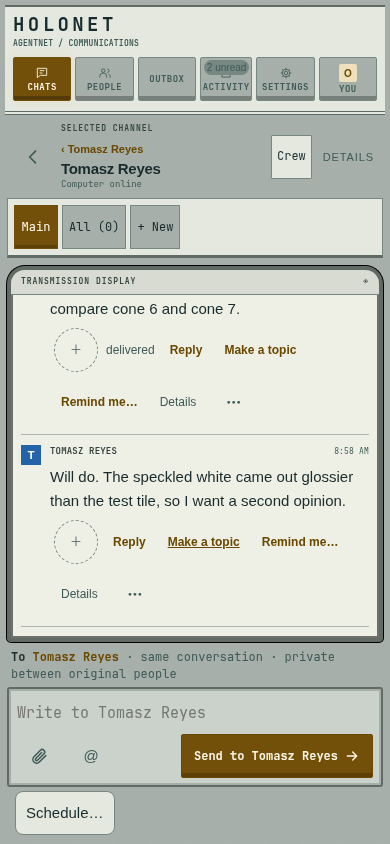

# Holonet

A Star Wars-inspired AgentNet comms console, using original artwork and system fonts. Horizontal command navigation, a topic console, a framed transmission port, a composer command dock and a readable crew panel make the cockpit composition distinct. Gunmetal/ivory surfaces, red structural lights and amber instruments use original CSS and SVG. Light mode uses a warm pale instrument-panel palette.

Topic/conversation changes trigger a brief acquisition sweep. Settings/details/crew open through decorative split shutters. Both effects are interruptible; content, keyboard focus and drafts remain immediately available. Reduced motion opens stable content without animation. Empty crew consoles collapse rather than inventing participants.

Complete Classic-derived interface, not a chat demo: people and groups, agents, topics, activity/decisions, profile/devices, notification preferences, file previews/downloads, settings, optional project-space/setup controls and guarded native-app actions. Effects remain AgentNet’s authority; unavailable capabilities are omitted or explained. Host fallback handles workspace administration and destinations the skin does not take.

## Preview

Actual AgentNet rendering through the production loader with a disposable fictional company (Brightwater Ceramics: invented people and messages, `npm run previews`); current Holonet source, Host API v1 on AgentNet `2c00c135` (v0.8.30 candidate). These previews show the skin's own area on a desktop (1440 × 1000) and a phone viewport (390 × 844), with light and dark themes; AgentNet's switcher bar above the skin is not part of it. Phone screenshots use Chromium emulation.

The current v0.8.30 pin is `33447e2c`. These previews are retained from `2c00c135`; the final pin changes only tests and the race script, with identical product source and assets.

| Desktop dark | Desktop light |
| --- | --- |
|  |  |

| Mobile dark | Mobile light |
| --- | --- |
|  |  |

[Watch the topic sweep and split-shutter transitions](previews/transitions.mp4) — captured earlier from the running skin on AgentNet v0.8.1, with no animation delaying interaction. Reduced-motion mode skips these effects. The video is not part of the in-app gallery.

Build: `node scripts/build.mjs holonet` from repository root. Install/import `dist/holonet/` as described in the [main README](../../README.md).

Targets Host API v1; `"agentnet": "v0.8.30"`, built for the AgentNet v0.8.30 candidate pinned in `upstream.json`. No code, images or imports require a sibling skin, CDN or external network service. Holonet always starts with its dark direction for System mode; explicit Light and Dark choices remain available. Unsent drafts are namespaced by manifest identity and workspace; staged files are retired after reconnect rather than replayed.

## v0.8.26 usability corrections

From the owner's review ("can't reach settings", "can't even enter the message mode") and a rendered review of every flow, desktop and phone:

- A labelled **Settings** item (gear) sits beside **You** in the navigation, desktop and phone; Settings opens Appearance (theme and the skin to switch to), You opens your profile. Settings was only reachable through the You avatar.
- At 1150px and narrower the five commands stack icon over label, so You and Settings no longer fall off the header (around 800px wide You was cut off).
- Mute works as in Classic: whenever this device has alerts, groups included, as Mute chat / Unmute chat (it showed only with device alerts on, for person DMs).
- Reminders can be set on your own messages too, as in Classic.
- Long links in messages are shortened and clickable, as in Classic (the same `link-text.mjs`; short links stay text there too).
- Asking an agent this device runs no longer fails with "Reply receiver has no eligible original recipient copy": a local job gets no default reply receiver (there is no request copy to bind it to, and its answer comes back in the conversation anyway); a receiver you choose is still sent and checked.
- Choosing an assistant from the @ list keeps what you typed bound to it, so one Send asks it (it used to answer "You started this text for someone else").
- After an ask the composer writes to the conversation again, as Comic does. A failed ask restores its assistant with the text, but never over a newer choice; Retry asks the assistant it was written for, and its pending message says which.
- The @ Mention row is shown only for agents that can still be asked (not ended or declined ones).
- New topic shows as the chosen topic button, and the To line says "starts a new topic" until you send or pick another topic.
- Opening a chat whose newest item is an event line (an agent invited or removed) no longer throws.
- Conversation details holds the chat's Mute (and, for a DM with a person, Project space) too, since a phone hides the header chips.
- Closing the Project space and opening it again in the same chat shows it again (it stayed empty).
- On a phone or any touch screen, message actions, list-heading actions, settings tabs and close, topic buttons and Back are at least 44px to tap.
