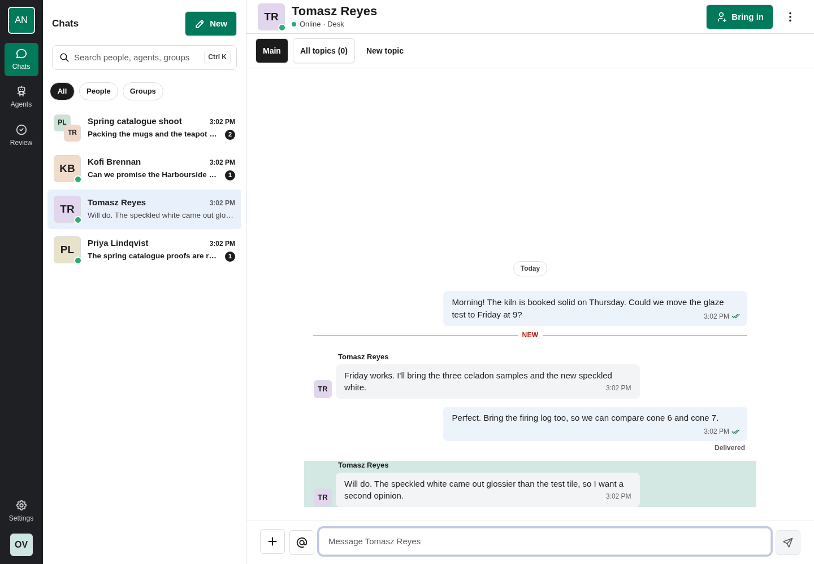
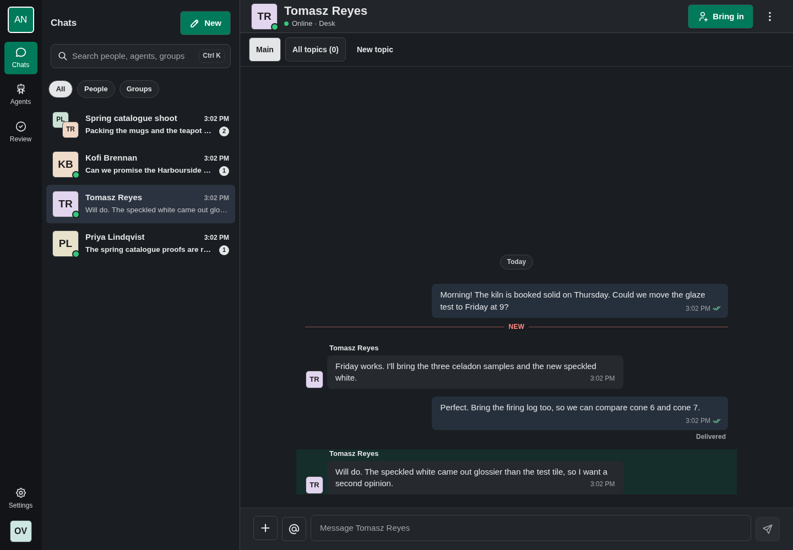
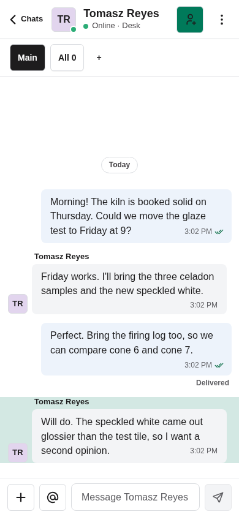
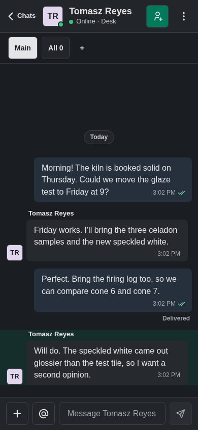

# Office

A plain workplace messenger, for people who want AgentNet to look like the
tools they already use at work. Office is an **overlay skin**: it is Comic,
AgentNet's default skin, with its own skin layer (`overlay/`), so it has
every Comic feature (chats, topics, agents, approvals, files, people,
settings, workspaces) and picks up Comic's fixes whenever it is rebuilt.

- **Quiet.** White pages, thin grey hairlines, a dark neutral rail, small
  corners. No stickers, no hard shadows, no dotted paper, no motion of its
  own.
- **System font.** Office bundles no fonts: text is set in the device's own
  interface font.
- **One green, one blue.** Green marks what you can do (New, Send, Bring in,
  the open tab); blue marks agents and keyboard focus.
- **Flat messages.** Messages are plain slips with small corners: yours a
  faint blue on the right, other people's light grey with their name above,
  an agent's with a hairline. Nothing moves beyond Comic's own transitions.
- **Plain requests.** A request that needs someone is a hairline card with a
  coloured edge: amber while it waits for you, blue while it runs, grey when
  stopped or handed over. The request's text and every action are AgentNet's
  own, always shown.
- **Directory avatars.** People are rounded squares with their initials on a
  muted tint; agents keep AgentNet's robot face in muted hues; a person's own
  picture wins; guests keep the dashed ring.
- **Light and dark.** Both themes keep text at 4.5:1 or better on its
  surface. Reduced motion is Comic's.

## Previews

Rendered with an invented company (Brightwater Ceramics: invented people and
messages), Office built from this overlay on AgentNet v0.8.32
(commit `3ba44749`). Desktop 1440 × 1000 and phone 390 × 844 previews show the
skin's own area; phone screenshots use Chromium emulation.

The release candidate pin is AgentNet v0.8.32 at `ac98b331`. These inspected previews were rendered on `3ba44749`, whose production, generated and runtime source bytes are identical to this candidate. The full collection gate passed against this exact candidate. Proposed gallery release `v2026.10.16.2` is not published.

| Desktop, light | Desktop, dark |
| --- | --- |
|  |  |

| Phone, light | Phone, dark |
| --- | --- |
|  |  |

## What is in the overlay

| File | Replaces Comic's |
| --- | --- |
| `theme.css` | Colours, the system font stack, corners, hairline shadows, the part styles (rail, list, rows, header, bubbles, composer) and Office's own pieces (send button, request card) |
| `document.css` | Nothing: no `@font-face`, so no bundled font is used |
| `brand.tsx` | Name, Settings line, the hash mark, storage under `office.` |
| `Avatar.tsx` | Comic's avatars with square corners and a muted palette |
| `SendButton.tsx` | The plain square send button |
| `RequestFrame.tsx` | The hairline request card with a coloured edge |

`TopicIntro.tsx` is Comic's (nothing above a topic's messages).

## Inspiration and limits

Inspired by workplace messengers in general: a sidebar of chats, a header,
flat messages, a bordered composer. It uses no product's logo, name, icons
or colours as a mark; the hash mark and the palette are Office's own.

## License

Apache-2.0, like AgentNet's Comic it builds on.
