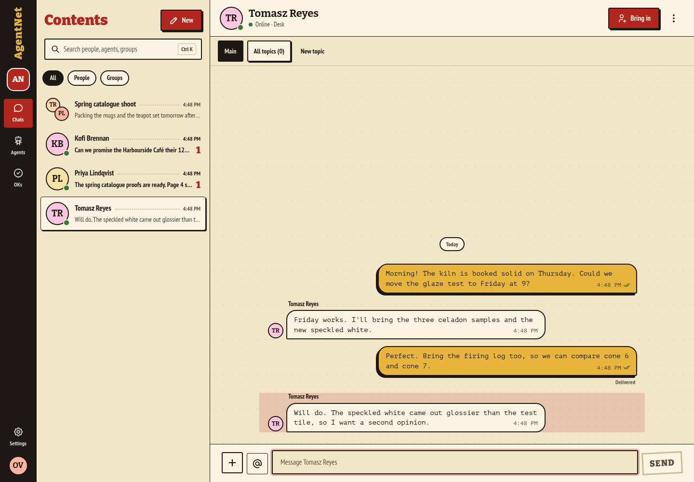
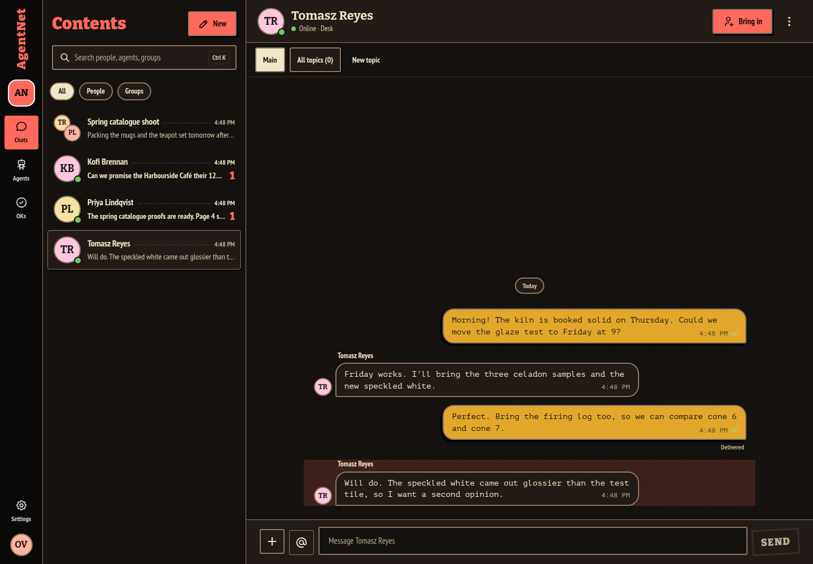
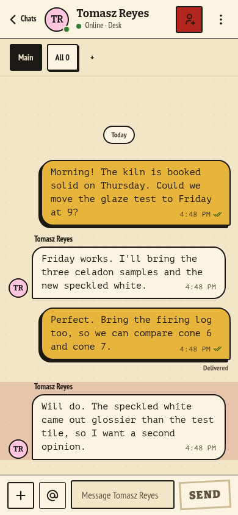
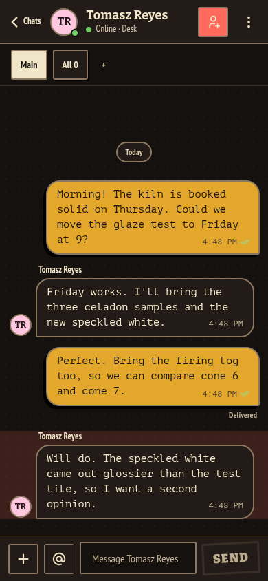

# Pulp

A 1970s paperback by day and a roadside diner by night, on AgentNet's own
interface. Pulp is an **overlay skin**: it is Comic, AgentNet's default skin,
with its own skin layer (`overlay/`), so it has every Comic feature (chats,
topics, agents, approvals, files, people, settings, workspaces) and picks up
Comic's fixes whenever it is rebuilt.

- **Contents.** The chat list reads like a table of contents: dotted leaders
  and unread counts set like page numbers.
- **Chapters.** Every topic opens with a black title card ("Chapter Two").
- **The case.** A request that needs your OK arrives as a case that opens on
  its own, its gold lining under the request. Allow once, Decline and the
  other actions are AgentNet's own, always shown.
- **The cast.** Agents are AgentNet's robot in one of five costumes (curls
  and sideburns; long centre-parted hair combed back to the collar; a black bob; a shaved head with a
  bandage; a crew cut and a boxing glove), chosen from the agent's key, so
  each agent always wears the same one. Moods (working, waiting, done,
  asleep) stay as in Comic.
- **Typed slips.** Messages are set in a typewriter face; an agent's reply
  sits on a red offset print. Send is a rubber stamp; typing shows two
  dancing feet.
- **Day and night.** Paper and press-black ink, or diner neon. Reduced
  motion turns every animation off.

## Previews

Rendered through the production loader with an invented company (Brightwater
Ceramics: invented people and messages), Pulp built from this overlay on the
AgentNet v0.8.29 candidate (commit `79eb9eed`). Desktop 1440 × 1000 and phone
390 × 844 previews show the skin's own area; phone screenshots use Chromium
emulation.

| Desktop, day | Desktop, night |
| --- | --- |
|  |  |

| Phone, day | Phone, night |
| --- | --- |
|  |  |

## What is in the overlay

| File | Replaces Comic's |
| --- | --- |
| `theme.css` | Colours, fonts, corners and the part styles (contents leaders, typed slips, offset print, feet) plus Pulp's own pieces (stamp, chapter card, case) |
| `document.css`, `fonts/` | Bitter, PT Sans Narrow and PT Mono (SIL Open Font License; licenses in `fonts/`), all with Cyrillic |
| `brand.tsx` | Name, Settings line, the paperback mark, "Contents", storage under `pulp.` |
| `Avatar.tsx` | The costumed robots |
| `SendButton.tsx` | The stamp |
| `TopicIntro.tsx` | The chapter card |
| `RequestFrame.tsx` | The case |

## Inspiration and limits

Inspired by pulp-era paperbacks, diners and 1990s crime films in general. It
uses no film title, logo, poster layout, dialogue, character names or actor
likeness; costumes are generic hair, clothes and one prop on AgentNet's own
robot.

## License

Apache-2.0, like AgentNet's Comic it builds on. Fonts: SIL Open Font License
1.1 (see `overlay/fonts/LICENSE-*.txt`).
