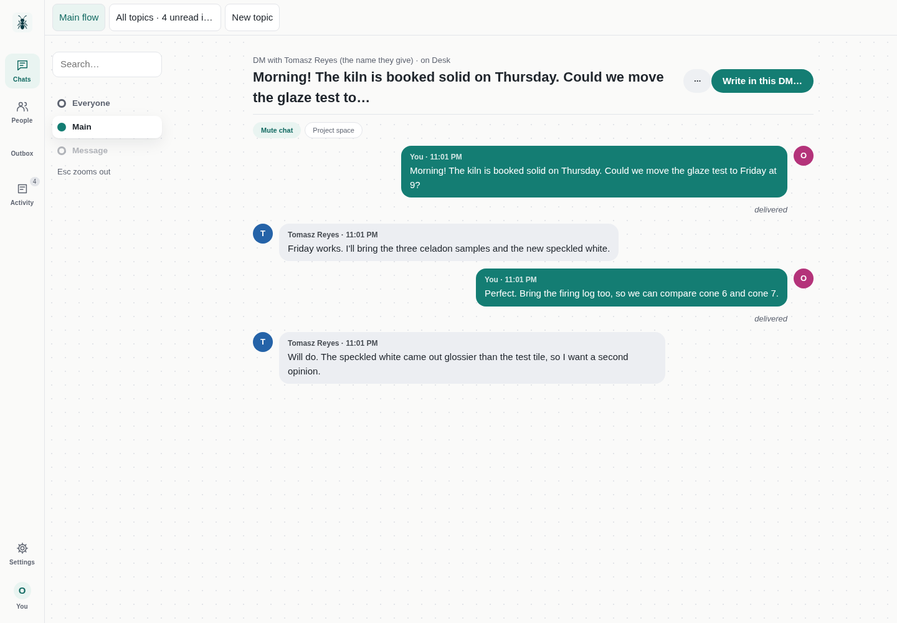
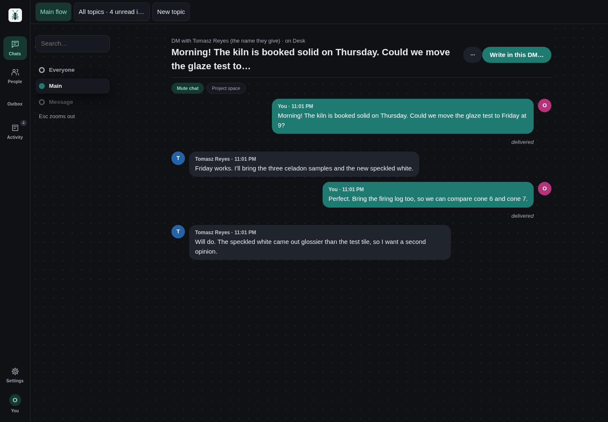
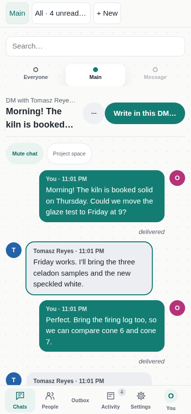
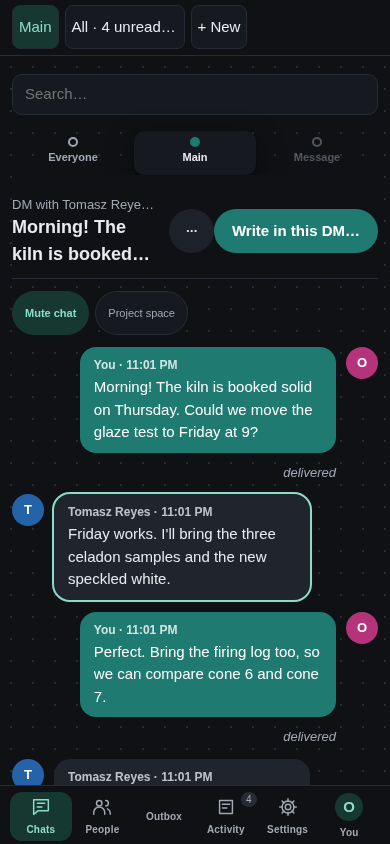

# Zoom

Move through your workspace by zooming in: everyone, then one person and their devices, then one conversation, then a single message with everything known about it. Esc steps back out one level at a time, and you write in a focused dialog. Topics, people, agents, activity, settings, files, notifications and the optional project-space and app controls are all still there; its hidden composer keeps drafts and staging shared with the dialog.

Zoom was built into AgentNet up to v0.8.24. From v0.8.25 AgentNet keeps only Comic built in, and Zoom installs from this collection (or the in-app skin gallery) like any other skin.

## Preview

The retained images below are historical production-loader renderings with a disposable fictional company (Brightwater Ceramics: invented people and messages), at desktop 1440 × 1000 and phone 390 × 844 in light/dark themes. Phone screenshots use Chromium viewport emulation. The v0.9.0 preview-regeneration and qualification record is preserved in [PROVENANCE.md](../../PROVENANCE.md).

The current source candidate targets AgentNet v0.9.1 at [`d5318cd92ccd48ebdc5caf771c409b2beb0104b4`](https://github.com/misunders2d/agentnet/tree/d5318cd92ccd48ebdc5caf771c409b2beb0104b4). Complete exact-pin qualification, candidate preview refresh and gallery publication are pending; these retained images do not qualify v0.9.1.

| Desktop light | Desktop dark |
| --- | --- |
|  |  |

| Phone light | Phone dark |
| --- | --- |
|  |  |

Build: `node scripts/build.mjs zoom` from the repository root. Install or import `dist/zoom/` as described in the [main README](../../README.md). Targets Host API v1; `"agentnet": "v0.9.1"`. Drafts are namespaced by manifest identity and workspace; staged files are retired after a reconnect rather than replayed. No code, image or import needs a sibling skin, a CDN or a network service.

## v0.8.26 usability corrections

From the owner's review ("can't reach settings", "can't even enter the message mode") and a rendered review of every flow, desktop and phone:

- A labelled **Settings** item (gear) sits beside **You** in the navigation, desktop and phone; Settings opens Appearance (theme and the skin to switch to), You opens your profile. Settings was only reachable through the You avatar.
- A person card, a DM row or a group row opens that chat (at its newest message's topic), not the single-message level: Zoom could look as if it had no way to write.
- Reply: the message level of a DM or group has a Reply action, and the write dialog shows the message it answers (× drops it).
- The chat level shows the chat's Mute and, for a DM with a person, Project space, whose panel opens in the chat level; Zoom never showed the header where they lived.
- Starting a new topic, the write dialog says "New topic with …".
- A person's agent lists only its current DMs (ended or declined ones stay in those DMs' history); "1 agent", not "1 agents"; a group's members and agents panels stay open across redraws.
- Touch: zoom-level disclosures, Write, Reply and the ladder are at least 44px to tap.
- Asking an agent this device runs no longer fails with "Reply receiver has no eligible original recipient copy": a local job gets no default reply receiver (there is no request copy to bind it to, and its answer comes back in the conversation anyway); a receiver you choose is still sent and checked.
- Choosing an assistant from the @ list keeps what you typed bound to it, so one Send asks it (it used to answer "You started this text for someone else").
- After an ask the composer writes to the conversation again, as Comic does. A failed ask restores its assistant with the text, but never over a newer choice; Retry asks the assistant it was written for, and its pending message says which.
- The @ Mention row is shown only for agents that can still be asked (not ended or declined ones).
- New topic shows as the chosen topic button, and the To line says "starts a new topic" until you send or pick another topic.
- Choosing Chats or People before the first overview has arrived no longer throws (`Cannot read properties of undefined (reading 'threads')`); that first overview draws the chosen section.
- Closing the Project space and opening it again in the same chat shows it again (it stayed empty).
- On a phone or any touch screen, message actions, list-heading actions, settings tabs and close, topic buttons and Back are at least 44px to tap.
- The blank 56px band under the interface is gone: it was kept free for a host control that now sits above every skin.
- Write is in the chat's header, in a DM, a group and a device conversation, and the header stays at the top while the history scrolls: with hundreds of messages it is in reach the moment the chat opens and anywhere in it (it used to sit after the last message). Keyboard focus and scrolling into view stop below the header. On a phone, a person's device-conversation button and conversation rows are 44px to tap.

## Provenance

Moved from [AgentNet](https://github.com/misunders2d/agentnet) at commit `b9c2a6e78be1d34f38f737517a7a5b0fe53a83b6`: the embedded package `internal/ui/static/skins/zoom/`, built there from `internal/ui/skins/zoom/src/`, the shared modules in `internal/ui/skins/shared/` (topics, person topics, mentions, reaction preferences, link text) and `internal/ui/static/` (pictures, optimistic sends). Apache-2.0, see [LICENSE](../../LICENSE) and [NOTICE](../../NOTICE). `qr.mjs` retains Paul Miller's copyright and `MIT OR Apache-2.0` notice; `link-text.mjs` bundles the marked Markdown lexer with its MIT and Markdown licence text, kept at the end of the file.

Changes from those bytes, only what the contract or this repository's checks require (the checks hold every standalone skin to the same journeys as Holonet):

- Identity comes from the package's own manifest (`manifest.id`) instead of the undocumented `host.skin` (drafts namespace `skinKey`, and `ownSkin` for the skin list), as Holonet does.
- Four `style` attributes set through `el()` (the proposal text in "How this task was chosen", the app-link fallback `<code>`, and the AgentNet command location) became CSS classes `proposal-text`, `copy-link` and `wrap-anywhere`, appended to `style.css`: AgentNet's content security policy (`style-src 'self'`) blocks style attributes, and this repository's source lint rejects them.
- The settings dialog's `close` listener is registered with the skin's unmount signal (`on(...)`), so a close event delivered after unmount no longer throws (`Cannot read properties of null (reading 'open')`, seen in the lifecycle check).
- `skin.json` adds `"agentnet": "v0.8.25"`: v0.8.24 and older reserve the id `zoom` for their built-in copy.
- Opening a file keeps its Download link when the view redraws while the file is still loading, so Open need not be chosen again (as Holonet does).
- Dark theme: the accent is `#1f7a71` (was `#329e92`), so white text on outgoing messages and primary buttons measures 5.15:1 (was 3.26:1, below 4.5:1).
- Phone: the write dialog's Send keeps a 44px touch target (it was 38.5px tall).
- Opening a message that is still loading (a new browser device syncing its history) waits for it, then shows its topic. Writing in that conversation or opening it again by hand now cancels that jump, so the view no longer moves to another topic under the person (the same code as Classic, where the journeys saw it).
- The conversation list is drawn only once the first overview has arrived; choosing a section earlier no longer throws (`Cannot read properties of undefined (reading 'threads')`).

The original move retained `internal/ui/static/skins/zoom/` at `b9c2a6e7` apart from the listed corrections. Later contract and feature updates are recorded in [PROVENANCE.md](../../PROVENANCE.md); current source is no longer described as byte-identical to that baseline. `manifest.mjs` is generated by `scripts/build.mjs` from `skin.json`.

The corrections above describe the original move and v0.8.26 follow-up. Before that move, AgentNet shipped this code up to v0.8.24 with those issues; later candidate updates have separate compatibility evidence.
